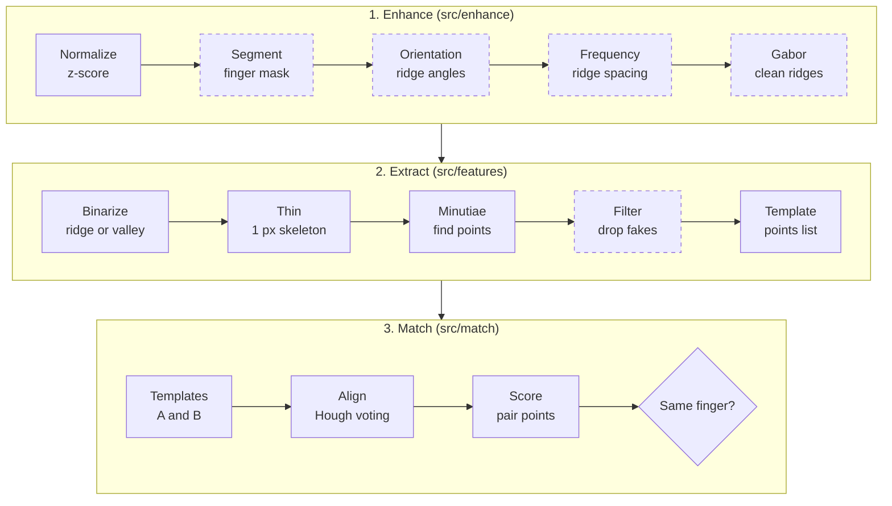

# fpmatch

A rule-based fingerprint matcher written in C++. It takes two fingerprint images and says whether they come from the same finger. There's no machine learning, just classic computer vision, signal processing and geometry.

**Status:** Phase 1 in progress. No baseline EER measured yet.

## Build and run

You need a C++17 compiler, CMake and OpenCV. On Ubuntu or WSL:

```bash
sudo apt install build-essential cmake libopencv-dev
cmake -S . -B build
cmake --build build
ctest --test-dir build
./build/fpmatch match data/101_1.tif data/101_2.tif
```

Put the FVC2002 DB1_B images in `data/` (see References). They aren't committed to the repo.

See [`docs/tools.md`](docs/tools.md) for how to use each OpenCV and CMake tool in this project.

## Overview

fpmatch finds the minutiae (ridge endings and bifurcations) in each print. Then it lines the two sets up and scores how many points agree.

Ground rules:

- Classic computer vision only. No machine learning.
- C++17 or newer, built with CMake on WSL.
- OpenCV is for plumbing only: loading and saving images, the `cv::Mat` container, `cv::blur`, `cv::filter2D`, `cv::Sobel` and drawing debug overlays. Every fingerprint algorithm is written by hand.
- Every stage saves a debug image so you can see what it did.
- Test data is FVC2002 DB1_B: 10 fingers with 8 prints each, scanned at 500 dpi.

The project is done when `fpeval` runs every pair in DB1_B and reports an error rate you can explain and improve.

## Pipeline at a glance

Each print becomes a list of points. Then two lists get aligned and scored.



Dashed boxes come in Phase 3. In Phase 1 they're skipped, so normalized pixels go straight to Binarize and raw minutiae go straight to Template. Both prints run through Enhance and Extract before they meet in Match.

## Repository file tree

The repo is one library (`fpcore`, everything in `src/`) plus two small apps that call it. The tests link to the same library, so no code gets copied. Each `name.hpp/.cpp` line means a header and a source file. The tag says which phase needs the file (see Build order).

```
fingerprint-matcher/
├── CMakeLists.txt               builds fpcore, both apps and the tests
├── README.md                    this file
├── .gitignore                   build/, data/, out/
├── docs/
│   └── tools.md                 how to use each OpenCV and CMake tool
├── data/                        FVC2002 DB1_B .tif files (not committed)
├── out/                         debug images, one folder per input (not committed)
├── src/
│   ├── core/
│   │   ├── types.hpp            [P1] BinaryImage, Minutia, Template, MatchResult
│   │   ├── config.hpp           [P1] every tuning number and stage on/off flag
│   │   ├── image_io.hpp/.cpp    [P1] load grayscale, save PNG, BinaryImage <-> cv::Mat
│   │   └── debug.hpp/.cpp       [P1] numbered debug dumps and overlays
│   ├── enhance/
│   │   ├── normalize.hpp/.cpp   [P1] z-score normalization
│   │   ├── binarize.hpp/.cpp    [P1] local threshold into ridge or valley
│   │   ├── segment.hpp/.cpp     [P3] foreground mask
│   │   ├── orientation.hpp/.cpp [P3] ridge angle per block
│   │   ├── frequency.hpp/.cpp   [P3] ridge spacing per block
│   │   └── gabor.hpp/.cpp       [P3] oriented filter bank
│   ├── features/
│   │   ├── thinning.hpp/.cpp    [P1] Zhang-Suen skeleton
│   │   ├── minutiae.hpp/.cpp    [P1] crossing number plus angle
│   │   └── filter.hpp/.cpp      [P3] remove false minutiae
│   ├── match/
│   │   ├── align.hpp/.cpp       [P1] Hough voting for rotation and shift
│   │   └── score.hpp/.cpp       [P1] pair up points, compute score
│   └── pipeline.hpp/.cpp        [P1] image in, Template out
├── apps/
│   ├── fpmatch.cpp              [P1] CLI: extract one print or match two
│   └── fpeval.cpp               [P2] runs the whole dataset, writes scores.csv
└── tests/
    ├── CMakeLists.txt
    ├── test_thinning.cpp        [P1]
    ├── test_minutiae.cpp        [P1]
    └── test_match.cpp           [P1]
```

Stretch work in Phase 4 adds `src/features/singular.hpp/.cpp` for cores and deltas. Don't create it until you get there.

## Core data types and angle rules

Seven types carry data between stages. They all live in `src/core/types.hpp`. This table only says what each one has to hold.

| Type | What it holds | Notes |
| --- | --- | --- |
| GrayImage | `cv::Mat` of `CV_32F` | Normalized pixels. Mean 0 and std dev 1 after normalize. |
| BinaryImage | width, height, flat `std::vector<uint8_t>`, an `at(x, y)` helper | 1 = ridge, 0 = valley. The mask reuses it with 1 = finger. |
| BlockField | a float per block, block size, blocks across, blocks down | Orientation and frequency both use it. One value per 16 x 16 block. |
| Minutia | x, y, angle, type | Type is ending or bifurcation. Angle runs 0 to 2π. |
| Template | list of Minutia, image width and height | What the pipeline returns for one print. |
| Alignment | rotation, dx, dy, vote count | The winning transform from Hough voting. |
| MatchResult | score from 0 to 1, matched pair count, the Alignment used | What comparing two Templates returns. |

Angle rules. Decide these once and never change them:

- Ridge orientation has no direction. Store it from 0 to π (0° to 180°).
- A minutia angle has a direction, because a ridge ending points one way. Store it from 0 to 2π.
- Use radians in code. Use degrees only in `config.hpp` and debug text.
- Image y points down. Pick whether positive angles turn clockwise or counterclockwise on screen. Write that choice in a comment in `types.hpp` and test it with a hand-drawn image.
- x is the column and y is the row. `cv::Mat::at` takes (row, col), which is (y, x).

## Stage specs

Each stage below is one module with one job. They're listed in pipeline order, and the tag says which phase builds it. This section pins down what goes in, what comes out and how you know it works.

### image_io and debug [P1]

- **Does:** loads a print as grayscale, converts between BinaryImage and `cv::Mat` and saves numbered debug PNGs.
- **OpenCV:** `imread`, `imwrite`, `normalize`, `cvtColor` for color overlays, `line`, `circle`.
- **Watch out:** `imread` returns an empty Mat on a bad path instead of crashing. `imwrite` wants 0 to 255, so map ridge to 0 and valley to 255. Float images need rescaling before you save them.
- **Done when:** a load then save round trip gives back the same picture.

### normalize [P1]

- **In:** raw 8-bit image. **Out:** GrayImage.
- **Key idea:** z-score. Subtract the mean and divide by the std dev so the same settings work on light and dark scans.
- **OpenCV:** `convertTo`, `meanStdDev`.
- **Watch out:** do the math in `CV_32F`. A blank image has std dev 0, so guard the divide.
- **Done when:** `01_normalized.png` looks like the input with even contrast.

### segment [P3]

- **In:** GrayImage. **Out:** mask as a BinaryImage.
- **Key idea:** split the image into blocks. Finger blocks swing between dark ridges and light valleys, so their variance is high. Background is flat, so its variance is low.
- **OpenCV:** `morphologyEx` is fine for filling small holes in the mask.
- **Watch out:** holes in the middle of the print and ragged edges.
- **Done when:** `02_mask.png` covers the whole print with no big holes and little background.

### orientation [P3]

- **In:** GrayImage, mask. **Out:** BlockField of angles from 0 to π, plus a coherence value per block that says how clear the flow is.
- **Key idea:** brightness changes fastest across a ridge. Gradients point across the ridges, so the ridge runs at a right angle to them. Combine the gradients in each block to get one flow angle.
- **OpenCV:** `Sobel` for gradients, `blur` for smoothing.
- **Watch out:** angles wrap at 180°, so you can't average them the normal way. Work out why before you read up on the fix. Noisy blocks give random angles, so smooth the field after you compute it.
- **Done when:** `03_orientation.png` draws a short line per block and the lines follow the ridges.

### frequency [P3]

- **In:** GrayImage, orientation, mask. **Out:** BlockField of ridge frequency, with 0 meaning unknown.
- **Key idea:** sample gray values along a line that cuts across the ridges in a block. The dark peaks repeat. The gap between peaks is the ridge period, and frequency is 1 over the period.
- **Watch out:** some blocks have no clear peaks. Mark them unknown and fill them from their neighbors.
- **Done when:** most blocks in `04_frequency.png` land around one ridge every 8 to 10 pixels.

### gabor [P3]

- **In:** GrayImage, orientation, frequency, mask. **Out:** enhanced GrayImage.
- **Key idea:** a Gabor filter is a wave pattern inside a soft blob. Tune it to each block's angle and spacing. It boosts ridges that match the local flow and smears noise away.
- **OpenCV:** `filter2D` runs the filter. Build the kernel yourself.
- **Watch out:** a new kernel per block is slow. Build a bank of kernels at fixed angles once and pick the closest one per block.
- **Done when:** `05_enhanced.png` shows clean, connected ridges where the raw print was smudged or broken.

### binarize [P1]

- **In:** GrayImage (normalized in P1, enhanced in P3). **Out:** BinaryImage.
- **Key idea:** local threshold. A pixel is a ridge if it's darker than the average of its neighborhood.
- **OpenCV:** `blur` for the local average. Use `adaptiveThreshold` only to check your answer.
- **Watch out:** window size versus ridge width. Polarity can flip once Gabor output replaces the raw pixels, so check it again in P3.
- **Done when:** `06_binary.png` has no solid blobs in dark areas and faint areas still show ridges.

### thinning [P1]

- **In:** BinaryImage. **Out:** skeleton as a BinaryImage.
- **Key idea:** Zhang-Suen. Peel edge pixels in two alternating sub-steps until a full pass changes nothing. The full rules are in Zhang and Suen (1984).
- **Watch out:** mark first, then delete. Decide what border pixels do. Zhang-Suen can leave small stair-steps on diagonal lines, and those confuse the minutiae stage.
- **Done when:** every ridge in `07_skeleton.png` is 1 pixel wide and no ridge broke that was solid in `06_binary.png`.

### minutiae [P1]

- **In:** skeleton, mask (P3). **Out:** list of Minutia.
- **Key idea:** crossing number. Walk the 8 neighbors of a skeleton pixel in a circle and count the switches between ridge and valley. Half that count tells you the type: 1 is an ending, 2 is the middle of a ridge and 3 is a bifurcation.
- **Angle:** follow the ridge a few pixels away from the point and measure that direction.
- **Watch out:** points at the image edge are fake because the ridges just got cut off there. A bifurcation has three branches, so decide which direction counts as its angle.
- **Done when:** `08_minutiae.png` marks endings and bifurcations in two colors with a short angle line on each, and they match what you'd mark by eye.

### filter [P3]

- **In:** minutiae, skeleton, mask. **Out:** cleaned minutiae.
- **Removes:** points near the mask edge, two endings facing each other across a small gap (a broken ridge), short spurs off a ridge, pairs sitting too close together and tiny ridge islands.
- **Done when:** `09_filtered.png` keeps the points you'd mark by hand and drops the clutter.

### align [P1]

- **In:** two Templates. **Out:** Alignment.
- **Key idea:** Hough voting. Take every pair of one minutia from A and one from B. Work out the rotation that matches their angles and the shift that then lands A's point on B's. Each pair casts one vote in a grid of (rotation, dx, dy) bins. The bin with the most votes wins.
- **Watch out:** bins that are too fine spread real matches across many bins. Bins that are too coarse let wrong alignments win. Rotation wraps at 360°. Pressure can turn an ending into a bifurcation, so test with and without a same-type rule.
- **Done when:** for a genuine pair, `aligned.png` draws A's points rotated and shifted onto B and most of them land on top of B's points.

### score [P1]

- **In:** two Templates, Alignment. **Out:** MatchResult.
- **Key idea:** apply the alignment to A. Pair each point with the closest unused point in B that falls within a distance tolerance and an angle tolerance. Each point gets used once. Turn the pair count into a score from 0 to 1.
- **Watch out:** skin stretches, so tolerances need some slack. A raw count favors prints with lots of minutiae, so divide by something based on how many points each print has. Pick a formula and be able to explain why.
- **Done when:** a handful of genuine pairs score clearly higher than impostor pairs.

### pipeline [P1]

- **Does:** runs the stages in order for one image and returns a Template.
- **Phase 1:** skips segment, orientation, frequency, gabor and filter.
- **Phase 3:** each skipped stage gets an on/off flag in `config.hpp`. Turn them on one at a time so `fpeval` shows what each one buys you.

## Command line tools and debug output

Two programs cover everything. `fpmatch` handles one or two images. `fpeval` handles the whole dataset.

| Command | What it does |
| --- | --- |
| `fpmatch extract <image>` | Runs the pipeline, writes debug images to `out/<image name>/` and prints the minutiae count |
| `fpmatch match <a> <b>` | Extracts both, aligns them and prints the score plus MATCH or NO MATCH |
| `fpeval <data dir>` | Runs the FVC protocol, writes `scores.csv` and prints FMR, FNMR and EER |

Debug files are numbered by their spot in the pipeline, so sorting by name shows them in order. A stage that's turned off just leaves a gap in the numbers.

| File | Written by |
| --- | --- |
| `01_normalized.png` | normalize |
| `02_mask.png` | segment |
| `03_orientation.png` | orientation (lines drawn over the print) |
| `04_frequency.png` | frequency (brighter = tighter ridges) |
| `05_enhanced.png` | gabor |
| `06_binary.png` | binarize |
| `07_skeleton.png` | thinning |
| `08_minutiae.png` | minutiae (overlay on the skeleton) |
| `09_filtered.png` | filter |
| `aligned.png` | align, in `out/<a>_vs_<b>/` |

The DB1_B files are named like `101_1.tif` through `110_8.tif`. The first number is the finger and the second is the impression. `imread` reads .tif files fine.

## Testing plan

Testing has two layers. Unit tests run on tiny hand-made images where you already know the right answer. Dataset evaluation runs on real prints and gives you the number to beat.

### Unit tests

Register them with CTest. Start with small test programs that use plain `assert` and return nonzero on failure. Move to Catch2 or GoogleTest later if you want nicer output.

- **test_thinning:** a bar 5 pixels thick becomes one line. A plus sign stays a plus sign. A line that's already 1 pixel wide doesn't change. A ring stays a closed ring.
- **test_minutiae:** a straight line has exactly 2 endings. A Y shape has 1 bifurcation and 3 endings. A horizontal line's endings have angles that match your angle rules.
- **test_match:** a Template against itself scores 1. A Template against a copy of itself rotated 30° and shifted by (10, -5) finds that exact alignment. Two random point sets score low.

The rotated copy test matters most. You make the answer yourself, so you know exactly what align should find.

### Dataset evaluation with fpeval

`fpeval` follows the FVC protocol ([described here](https://arxiv.org/pdf/1805.10853)):

- **Genuine pairs:** every print against every other print of the same finger. That's 28 pairs per finger and 280 in DB1_B.
- **Impostor pairs:** the first print of each finger against the first print of every other finger. That's 45 pairs. It's a small number, so add a mode that compares every cross-finger pair (2,880 of them).
- **scores.csv:** one row per comparison with print A, print B, genuine yes or no and the score.

The three numbers it reports:

- **FMR (false match rate):** the share of impostor pairs that score at or above the threshold.
- **FNMR (false non-match rate):** the share of genuine pairs that score below the threshold.
- **EER (equal error rate):** sweep the threshold until FMR equals FNMR. That rate is the EER. Lower is better.

Also plot genuine and impostor scores as two histograms. A spreadsheet is fine for that. The gap between the two piles shows you how well the matcher works better than any single number does.

## Build order

Build a rough version end to end first. Then measure it. Then upgrade one stage at a time and watch the EER move. Tick items off as you go.

### Phase 1: rough pipeline

- [ ] CMake project builds `fpcore`, `fpmatch` and one empty test
- [ ] image_io and debug: a load and save round trip works
- [ ] normalize
- [ ] binarize with a local threshold
- [ ] thinning with Zhang-Suen, plus test_thinning
- [ ] minutiae with crossing number and angles, plus test_minutiae
- [ ] align with Hough voting, plus the rotated copy test
- [ ] score
- [ ] `fpmatch match` prints a score for two images

Gate: a print against itself scores near 1 and a print against a different finger scores low.

### Phase 2: measure

- [ ] `fpeval` runs the FVC protocol and writes `scores.csv`
- [ ] FMR, FNMR and EER get computed and printed
- [ ] baseline EER written at the top of this README

Gate: you have one number to beat.

### Phase 3: quality upgrades

Turn on one stage, rerun `fpeval` and write down the new EER before you start the next one.

- [ ] segment
- [ ] orientation
- [ ] frequency
- [ ] gabor
- [ ] filter
- [ ] tune the numbers in `config.hpp`

Gate: each upgrade lowers the EER, or you can explain why it didn't.

### Phase 4: stretch

- [ ] find cores and deltas with the Poincaré index
- [ ] classify prints as loop, whorl or arch
- [ ] upgrade matching with local neighbor descriptors or Minutia Cylinder-Code
- [ ] time each stage and speed up the slowest one

## Tuning parameters

Every number below lives in `config.hpp` and nowhere else. Values from Hong et al. (1998) are tested for 500 dpi prints. The rest are rough starting guesses, so tune them with `fpeval`.

| Parameter | Used in | Start at | Where it comes from |
| --- | --- | --- | --- |
| Block size | segment, orientation, frequency | 16 x 16 px | Hong et al. |
| Mask variance cutoff | segment | tune by eye | Look at `02_mask.png` |
| Threshold window | binarize | your pick | Test a few sizes against ridge width |
| Valid ridge frequency | frequency | 1/25 to 1/3 per px | Hong et al. |
| Gabor sigma (x and y) | gabor | 4.0 | Hong et al. |
| Gabor angle steps | gabor | 16 | Starting guess |
| Border margin | minutiae, filter | about one block | Starting guess |
| Min distance between minutiae | filter | about one ridge period | Starting guess |
| Hough rotation bin | align | about 5° | Starting guess |
| Match distance tolerance | score | 10 to 15 px | Starting guess |
| Match angle tolerance | score | 15° to 20° | Starting guess |
| Match threshold | fpmatch | from fpeval | The EER point, or a target FMR |

## References

Papers (find them through Google Scholar or IEEE Xplore):

- Hong, Wan and Jain (1998). *Fingerprint Image Enhancement: Algorithm and Performance Evaluation.* IEEE TPAMI. The source for normalize, orientation, frequency and gabor.
- Zhang and Suen (1984). *A Fast Parallel Algorithm for Thinning Digital Patterns.* Communications of the ACM. The thinning stage.
- Ratha, Karu, Chen and Jain (1996). *A Real-Time Matching System for Large Fingerprint Databases.* IEEE TPAMI. Hough-based alignment.
- Cappelli, Ferrara and Maltoni (2010). *Minutia Cylinder-Code.* IEEE TPAMI. The Phase 4 matcher upgrade.
- Maltoni, Maio, Jain and others. *Handbook of Fingerprint Recognition.* Springer. The whole field in one book.

Data:

- [FVC2002 competition site](http://bias.csr.unibo.it/fvc2002/), home of DB1_B.
- [robertvazan/fingerprint-datasets](https://github.com/robertvazan/fingerprint-datasets), which lists the FVC sample sets with sizes and formats.
- [DB1_B details](https://arxiv.org/pdf/1601.02225): 10 fingers, 8 impressions, 388 x 374 px at 500 dpi.