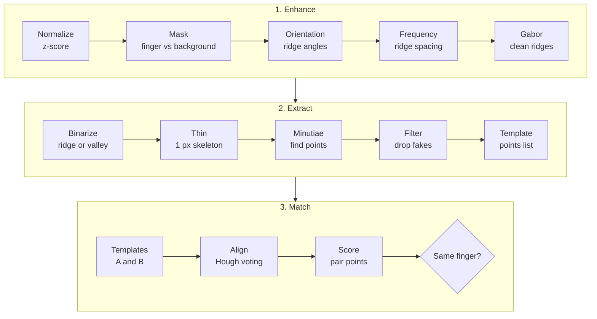

# fpmatch

A rule-based fingerprint matcher written in C++. It finds the ridge endings and bifurcations in a print, lines two prints up and scores how many points agree. It can keep a small local database of prints and search it. There's no machine learning and nothing leaves your computer. It uses classic image processing, signal processing and geometry only.

**Status:** done. EER on FVC2002 DB1_B is **13.45%** (24.0% without enhancement). See `docs/briefing.md` for how every part works.

## Build and run

You need a C++17 compiler, OpenCV and pkg-config. On Ubuntu or WSL:

```bash
sudo apt install build-essential libopencv-dev pkg-config
make                            # compile only
make run                        # builds and runs on data/101_1.tif
make run IMG=data/104_3.tif     # a different print
make clean                      # deletes build/ and out/
```

Put test prints in `data/` (see References). They aren't committed to the repo. Neither is anything in `db/`.

## Commands

| Command | What it does |
| --- | --- |
| `fpmatch <image>` | Analyzes one print, saves its results in `out/<print name>/` and shows the case menu |
| `fpmatch import <folder>` | Analyzes and catalogues every `.tif`, `.png`, `.bmp` and `.jpg` in a folder. Names come from the file names |
| `fpmatch eval <folder>` | Runs the FVC test on an FVC "B" set, writes `out/eval/scores.csv` and prints FMR, FNMR and EER |

Add `--no-enhance` to any command to skip the orientation, frequency and Gabor stages. That's only for experiments. Templates made that way are marked `1-plain` in the database.

### The case menu

After `fpmatch <image>` finishes, the results wait in `out/<print name>/`. Nothing goes into the database until you say so.

```
 [a] Catalogue this print
 [b] Compare against another print
 [c] Search the database
 [d] Discard results
 [q] Quit (leave results in out/)
```

- **Catalogue** asks for a name and a finger (leave it blank for "unknown"). It gives the print the next ID (0001, 0002 ...), copies the original file, the skeleton and the template into `db/`, adds a row to `db/index.csv` and then deletes `out/<print name>/`. If anything goes wrong, `out/` is left alone so you can try again.
- **Compare** asks for a second image, analyzes it the same way and shows MATCH or NO MATCH with the score. The overlay goes in `out/<a>_vs_<b>/aligned.png`.
- **Search** scores the print against every print in the database and shows the top 5 with their raw and skeleton paths. The software suggests. The examiner decides.
- **Discard** deletes `out/<print name>/`.

## Pipeline at a glance

Each print becomes a list of points. Then two lists get aligned and scored.



## Repository file tree

```
fingerprint-analysis/
├── Makefile                   builds every .cpp in src/ into build/fpmatch
├── README.md                  this file
├── .gitignore                 build/, out/, data/ and the contents of db/
├── docs/
│   ├── info.txt               what each folder is for
│   └── briefing.md            how every stage works, for learning and teaching
├── src/
│   ├── ui.hpp                 terminal UI: banner, stages, menu, verdicts
│   ├── fingerprint.hpp        shared structs and every function declaration
│   ├── image_processing.cpp   load, normalize, mask, binarize, thin
│   ├── enhance.cpp            orientation field, ridge frequency, Gabor filter
│   ├── minutiae.cpp           find minutiae, filter fakes, save and load templates
│   ├── matching.cpp           Hough alignment, pairing, score (all tuning numbers at the top)
│   ├── database.cpp           index.csv, catalogue, search, discard
│   └── main.cpp               command line, case menu, pipeline, eval
├── data/                      test prints (not committed)
├── out/                       results waiting to be catalogued (not committed)
└── db/                        the print database (contents not committed)
    ├── index.csv
    ├── raw/                   original image files, named by ID
    ├── skel/                  skeleton images, named by ID
    └── tmpl/                  templates, named by ID
```

## Debug images

Every stage saves a picture in `out/<print name>/`, numbered in pipeline order.

| File | Written by |
| --- | --- |
| `00_raw.png` | load |
| `01_normalized.png` | normalize |
| `02_mask.png` | mask (black = finger) |
| `03_orientation.png` | orientation (red lines along the ridges) |
| `04_frequency.png` | frequency (brighter = ridges closer together) |
| `05_enhanced.png` | Gabor |
| `06_binary.png` | binarize |
| `07_skeleton.png` | thin |
| `08_minutiae.png` | minutiae (red = ending, blue = bifurcation) |
| `09_filtered.png` | filter |
| `template.tmpl` | the template that gets matched |
| `aligned.png` | compare, in `out/<a>_vs_<b>/` (blue = B, red = A moved onto B, green = paired) |

## Data formats

**Minutia angles.** Radians from 0 to 2π, like on a math graph: 0 points right and π/2 points up on screen. Image y points down, so every `atan2` flips dy. An ending points out of the ridge tip. A bifurcation points away from its single trunk ridge.

**Template (`.tmpl`).** Plain text. A header line, then one minutia per line.

```
fpmatch-template 1 388 374 23
210 39 5.7760868027872494 ending
118 152 1.2490457723982544 bifurcation
```

The header is `fpmatch-template <version> <width> <height> <count>`. Angles are written with 17 digits so a save and load gives back exactly the same numbers.

**Index (`db/index.csv`).** `id,name,finger,raw,skeleton,template,added,version`. `added` is `YYYY-MM-DD HH:MM`. `version` is the pipeline version, so old templates can be found and re-analyzed if the pipeline changes. Names and fingers can't contain commas.

## Evaluation

`fpmatch eval data` follows the FVC protocol ([described here](https://arxiv.org/pdf/1805.10853)):

- **Genuine pairs:** every print against every other print of the same finger. That's 28 pairs per finger.
- **Impostor pairs:** the first print of each finger against the first print of every other finger. That's 45 pairs for 10 fingers.
- **FMR (false match rate):** the share of impostor pairs that score at or above the threshold.
- **FNMR (false non-match rate):** the share of genuine pairs that score below the threshold.
- **EER (equal error rate):** the rate where FMR and FNMR are equal. Lower is better.

Results on DB1_B (76 prints, since finger 104 only has 4 impressions here, so 258 genuine pairs):

| Version | EER |
| --- | --- |
| Baseline: no enhancement | 24.04% |
| With orientation, frequency and Gabor | 15.53% |
| Plus same-type voting and 5 Hough peaks (final) | **13.45%** |

The match threshold (0.028) sits at the final EER point.

## Tuning parameters

Values from Hong et al. (1998) are tested for 500 dpi prints. The rest were tuned with `fpmatch eval`.

| Parameter | File | Value |
| --- | --- | --- |
| Mask block size, variance cutoff | main.cpp | 16 px, 0.1 |
| Binarize window | main.cpp | 15 px |
| Orientation smoothing passes | enhance.cpp | 2 |
| Frequency window | enhance.cpp | 32 x 16 px (Hong) |
| Valid ridge period | enhance.cpp | 3 to 25 px (Hong) |
| Gabor sigma | enhance.cpp | 4.0 (Hong) |
| Gabor angles | enhance.cpp | 16 |
| Angle trace length | minutiae.cpp | 10 px |
| Border margin | minutiae.cpp | 12 px |
| Spur length, island length | minutiae.cpp | 12 px, 15 px |
| Broken ridge gap and angle | minutiae.cpp | 15 px, 45° |
| Min distance between minutiae | minutiae.cpp | 6 px |
| Hough bins | matching.cpp | 5°, 8 px |
| Max rotation, max shift | matching.cpp | 60°, 300 px |
| Hough peaks tried | matching.cpp | 5 |
| Same-type voting | matching.cpp | on |
| Match distance, match angle | matching.cpp | 12 px, 20° |
| Match threshold | matching.cpp | 0.028 |

## Ideas for later

- Find cores and deltas with the Poincaré index.
- Classify prints as loop, whorl or arch.
- Match with local neighbor descriptors or Minutia Cylinder-Code.
- Speed up the slowest stage (Gabor).

## References

Papers (find them through Google Scholar or IEEE Xplore):

- Hong, Wan and Jain (1998). *Fingerprint Image Enhancement: Algorithm and Performance Evaluation.* IEEE TPAMI. The source for orientation, frequency and Gabor.
- Zhang and Suen (1984). *A Fast Parallel Algorithm for Thinning Digital Patterns.* Communications of the ACM. The thinning stage.
- Ratha, Karu, Chen and Jain (1996). *A Real-Time Matching System for Large Fingerprint Databases.* IEEE TPAMI. Hough-based alignment.
- Cappelli, Ferrara and Maltoni (2010). *Minutia Cylinder-Code.* IEEE TPAMI. A possible matcher upgrade.
- Maltoni, Maio, Jain and others. *Handbook of Fingerprint Recognition.* Springer. The whole field in one book.

Data:

- [FVC2002 competition site](http://bias.csr.unibo.it/fvc2002/), home of DB1_B.
- [robertvazan/fingerprint-datasets](https://github.com/robertvazan/fingerprint-datasets), which lists the FVC sample sets with sizes and formats.
- [DB1_B details](https://arxiv.org/pdf/1601.02225): 10 fingers, 8 impressions, 388 x 374 px at 500 dpi.
